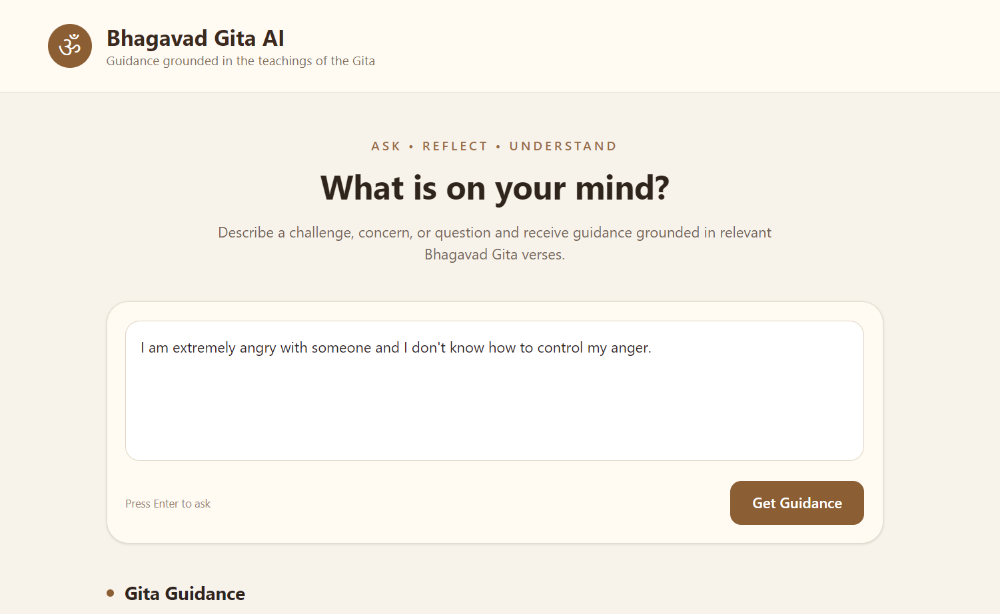
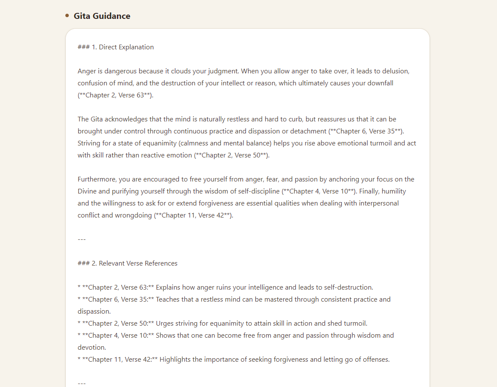
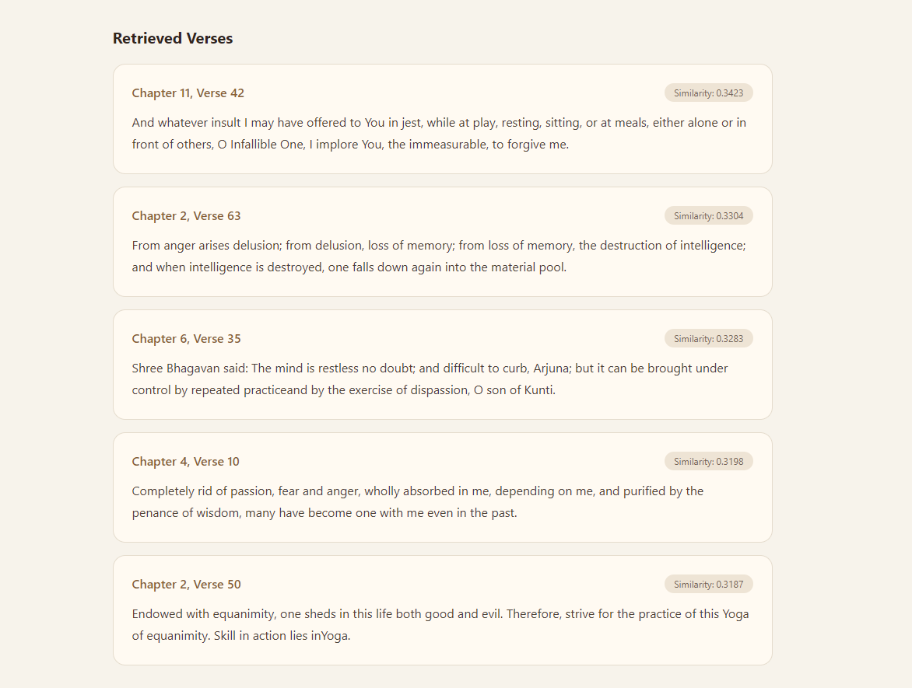

# 🕉️ Bhagavad Gita RAG Assistant

> A Retrieval-Augmented Generation (RAG) application that provides guidance grounded in relevant verses from the Bhagavad Gita.

The **Bhagavad Gita RAG Assistant** combines semantic search, vector databases, transformer-based embeddings, and an LLM to retrieve relevant verses from the Bhagavad Gita and generate contextual responses grounded in those retrieved passages.

The project was built to explore how modern **NLP, semantic retrieval, vector search, and RAG architectures** can be applied to a domain-specific knowledge base.

---

## ✨ Features

- 🔎 Semantic search across **701 Bhagavad Gita verses**
- 🧠 Transformer-based sentence embeddings
- ⚡ FAISS vector similarity search
- 📚 Domain-specific retrieval using `all-mpnet-base-v2`
- 🤖 Gemini-powered response generation
- 📖 Responses grounded in retrieved Bhagavad Gita verses
- 🎯 Recall@K retrieval evaluation
- 🔬 Comparison of different retrieval architectures
- 🌐 FastAPI backend
- 💻 React + Vite frontend
- 🎨 Tailwind CSS interface
- 📜 Chapter and verse references in generated responses
- 🛡️ Relevance safeguard for unrelated questions

---

# 📸 Application Preview

### 1. Ask a Question

Users can describe a problem, concern, or question and ask the assistant for guidance.



---

### 2. AI-Generated Guidance

The retrieved verses are passed to the language model as context so that the generated response is grounded in the Bhagavad Gita.



---

### 3. Retrieved Verses

The application also displays the verses retrieved by the semantic search system together with their similarity scores.



---

# 🎯 Project Objective

The goal of this project was to build a domain-specific RAG system capable of answering user questions using the Bhagavad Gita as its knowledge base.

Instead of sending a user question directly to an LLM, the system first searches the Bhagavad Gita for semantically relevant verses.

The retrieved verses are then provided to the LLM as context.

This creates the following pipeline:

```text
User Question
      ↓
MPNet Embedding Model
      ↓
FAISS Semantic Search
      ↓
Top-K Relevant Verses
      ↓
Retrieved Context
      ↓
Gemini LLM
      ↓
Grounded Response
```

---

# 🧠 Why RAG?

A general-purpose language model may generate an answer based on its broad training data.

For this project, the objective is different.

The assistant should primarily use the **Bhagavad Gita as its knowledge source**.

RAG helps achieve this by separating the system into two stages:

### 1. Retrieval

The user's question is converted into a vector representation and compared against vectors representing the Bhagavad Gita verses.

The most semantically similar verses are retrieved.

### 2. Generation

The retrieved verses are provided to the LLM as context.

The LLM then generates a response based on those passages.

```text
Question
   ↓
Embedding
   ↓
Vector Search
   ↓
Relevant Verses
   ↓
Context
   ↓
LLM
   ↓
Answer
```

---

# 📚 Dataset

The project uses the **Bhagavad Gita dataset** containing:

- 18 chapters
- 701 verses
- Sanskrit text
- Hindi text
- English translation
- Transliteration

The dataset was cleaned and transformed before being used for retrieval.

### Dataset preprocessing

The preprocessing pipeline:

1. Loads the original dataset
2. Normalizes text
3. Creates stable verse IDs
4. Removes duplicate verse IDs
5. Sorts verses by chapter and verse
6. Creates retrieval documents

Example verse ID:

```text
BG_2_63
```

representing:

```text
Bhagavad Gita
Chapter 2
Verse 63
```

---

# 🏗️ System Architecture

```text
                         ┌────────────────────┐
                         │    User Question   │
                         └─────────┬──────────┘
                                   │
                                   ▼
                      ┌────────────────────────┐
                      │ all-mpnet-base-v2      │
                      │ Sentence Embeddings   │
                      └──────────┬─────────────┘
                                 │
                                 ▼
                      ┌────────────────────────┐
                      │        FAISS           │
                      │ Vector Similarity      │
                      │ Search                 │
                      └──────────┬─────────────┘
                                 │
                                 ▼
                      ┌────────────────────────┐
                      │ Top 5 Relevant Verses │
                      └──────────┬─────────────┘
                                 │
                                 ▼
                      ┌────────────────────────┐
                      │ Context Construction   │
                      └──────────┬─────────────┘
                                 │
                                 ▼
                      ┌────────────────────────┐
                      │      Gemini LLM        │
                      │ Grounded Generation    │
                      └──────────┬─────────────┘
                                 │
                                 ▼
                      ┌────────────────────────┐
                      │ Gita Guidance +        │
                      │ Verse References       │
                      └────────────────────────┘
```

---

# 🔍 Retrieval Pipeline

Each Bhagavad Gita verse is converted into a semantic vector representation.

The project initially experimented with two embedding models:

### MiniLM

```text
all-MiniLM-L6-v2
Embedding dimension: 384
```

### MPNet

```text
all-mpnet-base-v2
Embedding dimension: 768
```

The MPNet-based architecture produced the strongest overall retrieval performance among the tested approaches and was therefore selected for the final application.

---

# 📊 Retrieval Evaluation

A manually curated evaluation set containing **25 user-style questions** was created to evaluate retrieval quality.

The main evaluation metric was:

> **Recall@K**

Recall@K measures whether at least one expected relevant verse appears within the top K retrieved results.

### Results

| Retrieval Architecture | Recall@1 | Recall@3 | Recall@5 | Recall@10 |
|---|---:|---:|---:|---:|
| MiniLM + FAISS | 36% | 48% | 56% | 68% |
| MPNet + FAISS | **36%** | **56%** | **56%** | **72%** |
| MPNet + Cross-Encoder Reranking | 20% | 40% | 56% | 68% |

### Selected Architecture

The final system uses:

```text
all-mpnet-base-v2
        +
FAISS
```

The MPNet architecture achieved the highest Recall@3 and Recall@10 among the tested approaches.

---

# 🧪 Reranking Experiment

A cross-encoder reranking architecture was also tested.

The pipeline was:

```text
User Query
    ↓
MPNet Embedding
    ↓
FAISS Top-20 Retrieval
    ↓
Cross-Encoder Reranking
    ↓
Final Results
```

The tested cross-encoder did not improve retrieval performance on the project-specific evaluation set.

Instead of assuming that a more complex architecture would automatically perform better, the final system retained the simpler **MPNet + FAISS** architecture.

This experiment helped evaluate the practical trade-off between retrieval complexity and performance.

---

# 🤖 Generative AI Layer

After retrieving the most relevant verses, the system constructs a context containing:

- Chapter number
- Verse number
- Verse ID
- English translation
- Similarity score

This context is passed to Gemini with instructions to generate an answer grounded in the retrieved passages.

The model is instructed to:

- Use the retrieved passages as the primary knowledge source
- Reference relevant chapters and verses
- Avoid inventing unsupported teachings
- Acknowledge when retrieved passages are insufficient
- Provide practical interpretation while remaining grounded in the source material

---

# 🛡️ Relevance Handling

Semantic retrieval will always return something, even when the question is unrelated to the knowledge base.

For example:

```text
How do I fix my laptop?
```

does not have a meaningful Bhagavad Gita answer.

The system therefore includes relevance handling so that unrelated questions can result in:

```text
I couldn't find sufficiently relevant Bhagavad Gita
passages to answer this question reliably.
```

This helps reduce unsupported or hallucinated responses.

---

# ⚙️ Technology Stack

## Machine Learning / NLP

- Python
- Sentence Transformers
- `all-mpnet-base-v2`
- FAISS
- NumPy
- Pandas

## Generative AI

- Google Gemini API
- Gemini Flash model

## Backend

- FastAPI
- Uvicorn
- Pydantic

## Frontend

- React
- Vite
- TypeScript
- Tailwind CSS

## Development Tools

- Git
- GitHub
- VS Code

---

# 📁 Project Structure

```text
gita-rag/
│
├── data/
│   ├── bhagavad_gita.csv
│   ├── bhagavad_gita_clean.csv
│   ├── evaluation_queries.csv
│   ├── gita_documents.csv
│   ├── gita.index
│   ├── gita_metadata.pkl
│   ├── gita_mpnet.index
│   └── gita_mpnet_metadata.pkl
│
├── src/
│   ├── api.py
│   ├── create_documents.py
│   ├── create_embeddings.py
│   ├── create_mpnet_embeddings.py
│   ├── evaluate_retrieval.py
│   ├── preprocess.py
│   ├── rag.py
│   ├── rerank_retrieval.py
│   └── search.py
│
├── frontend/
│   ├── src/
│   ├── public/
│   ├── package.json
│   └── vite.config.ts
│
├── 1.jpg
├── 2.jpg
├── 3.jpg
├── eda.py
├── requirements.txt
├── .gitignore
└── README.md
```

---

# 🚀 Getting Started

## 1. Clone the repository

```bash
git clone <YOUR_GITHUB_REPOSITORY_URL>
cd gita-rag
```

---

# 🐍 Backend Setup

Create a virtual environment:

### Windows

```powershell
python -m venv venv
```

Activate it:

```powershell
.\venv\Scripts\Activate.ps1
```

Install dependencies:

```powershell
pip install -r requirements.txt
```

---

# 🔑 Configure Gemini API

Create a Gemini API key and configure it as an environment variable.

### PowerShell

```powershell
$env:GEMINI_API_KEY="YOUR_API_KEY"
```

Verify:

```powershell
python -c "import os; print(bool(os.getenv('GEMINI_API_KEY')))"
```

Expected:

```text
True
```

> Never commit your API key to GitHub.

---

# ▶️ Run the FastAPI Backend

From the project root:

```powershell
uvicorn src.api:app --reload
```

The API should be available at:

```text
http://127.0.0.1:8000
```

FastAPI's interactive API documentation is available at:

```text
http://127.0.0.1:8000/docs
```

---

# 💻 Run the Frontend

Open another terminal:

```powershell
cd frontend
npm install
npm run dev
```

Vite will provide a local development URL similar to:

```text
http://localhost:5173
```

Open the URL in your browser.

---

# 🔌 API

The frontend communicates with the FastAPI backend through the `/ask` endpoint.

### Request

```json
{
  "query": "I am extremely angry with someone and I don't know how to control my anger."
}
```

### Response

The API returns:

- Generated guidance
- Retrieved verses
- Chapter numbers
- Verse numbers
- Similarity scores

Example structure:

```json
{
  "answer": "...",
  "verses": [
    {
      "verse_id": "BG_2_63",
      "chapter": 2,
      "verse": 63,
      "english": "...",
      "similarity": 0.3304
    }
  ]
}
```

---

# 🧪 Example Questions

### Emotional Control

```text
I am extremely angry with someone and I don't know how to control my anger.
```

### Fear

```text
How can I overcome fear?
```

### Work and Results

```text
I am working really hard but I am worried that I won't get the results I want.
```

### Stress

```text
I am very stressed and I don't know how to manage my responsibilities.
```

For unrelated questions such as:

```text
How do I fix my laptop?
```

the system attempts to avoid generating unsupported Bhagavad Gita guidance.

---

# 📈 Evaluation Methodology

The retrieval system was evaluated using 25 manually curated queries.

For every query:

1. The question is embedded.
2. FAISS retrieves the nearest verses.
3. Retrieved verse IDs are compared with expected relevant verse IDs.
4. Recall@1, Recall@3, Recall@5 and Recall@10 are calculated.

This evaluation is intended as a **prototype benchmark**, since relevance labels were manually curated rather than obtained from a formal expert-annotated dataset.

---

# 🔬 Key Learning Outcomes

Through this project, I explored:

- Semantic search
- Transformer embeddings
- Vector databases
- FAISS similarity search
- Retrieval-Augmented Generation
- Prompt grounding
- Recall@K evaluation
- Embedding model comparison
- Cross-encoder reranking
- Domain-specific retrieval
- FastAPI API development
- React frontend integration
- LLM-based response generation

---

# ⚠️ Limitations

This project is a learning and portfolio implementation rather than a production-grade spiritual advisory system.

Some limitations include:

- The evaluation dataset contains only 25 manually curated queries.
- Retrieval relevance depends on the quality of the embedding model.
- Semantic similarity does not guarantee philosophical correctness.
- The English translations used by the dataset may differ from other Bhagavad Gita translations.
- Generated responses can still require human interpretation.
- The application should not be treated as professional medical, psychological, legal, or other expert advice.

---

# 🔮 Future Improvements

Potential future improvements include:

- Hybrid keyword + semantic retrieval
- Better domain-specific reranking
- Multilingual retrieval using Sanskrit/Hindi content
- Verse-level metadata filtering
- Conversation history
- Improved relevance classification
- Evaluation with a larger expert-annotated benchmark
- Deployment using Docker
- Cloud deployment of the FastAPI backend
- Authentication and usage monitoring

---

# 👨‍💻 Author

**Tanmay Singh**

B.Tech Computer Science & Technology  
SRM University

Areas of interest:

- Machine Learning
- NLP
- Generative AI
- Retrieval-Augmented Generation
- Full-Stack Development
- Data Science

---

# ⭐ Project Summary

The Bhagavad Gita RAG Assistant demonstrates an end-to-end AI application that combines:

```text
Data
 ↓
Preprocessing
 ↓
Transformer Embeddings
 ↓
FAISS Vector Search
 ↓
Retrieval Evaluation
 ↓
RAG Context Construction
 ↓
Gemini Generation
 ↓
FastAPI
 ↓
React Frontend
```

The project focuses on building and evaluating a complete domain-specific RAG pipeline rather than simply calling an LLM API.